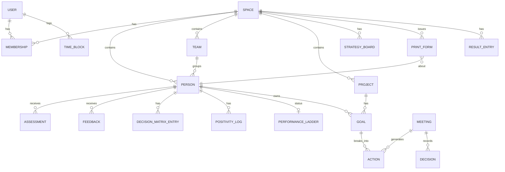

# 04 · Modelo de dados (proposta)

**Status:** IN_REVIEW · Modelo lógico para PostgreSQL. Todo registro de negócio tem `space_id` (isolamento por espaço), `created_at`, `created_by`, `updated_at` e, nas tabelas sensíveis, histórico em `audit_log`. Nomes em inglês no código, rótulos em pt-BR na interface.

## Diagrama

## Núcleo
| Tabela | Campos principais |
|---|---|
| `user` | id, nome, e-mail, hash de senha ou provedor, 2FA, idioma |
| `space` | id, nome, **tipo** (`personal`, `team`, `third_party`), dono, **política de transparência** (`open`, `partial`, `reserved`), logo |
| `membership` | user_id, space_id, **papel** (`owner`, `leader`, `member`, `mentee`, `consultant`), líder direto, início, fim |
| `person` | id, space_id, user_id (opcional), nome, cargo, team_id, líder direto, data de entrada, status |
| `team` | id, space_id, nome, líder |

## Pessoas
| Tabela | Campos principais |
|---|---|
| `assessment` | id, person_id, tipo (`chac`, `gap`, `profile`, `maas`, `plenitude`, `360`), data, autor, notas (JSON), observações |
| `decision_matrix_entry` | person_id, mês, nota técnica (0-10), nota emocional (0-10), quadrante calculado, decisão do gestor, justificativa |
| `feedback` | id, person_id, autor, data, assunto, texto, compromisso, prazo, tipo (`praise`, `guidance`, `observation`), assinado_em, origem (`app`, `paper`) |
| `corrective_notice` | id, person_id, autor, data, testemunha, problema, histórico, consequência prevista, plano acordado, reunião (1ª/2ª/3ª), assinaturas, anexo escaneado; **modelo validado por advogado** |
| `performance_ladder` | person_id, fase (`proactive`, `reactive`, `rescue`, `elimination`), passo (1 a 10), desde, motivo |
| `onboarding_review` | person_id, critérios (16, JSON), nota 1-5 por data (dia 7, 14, 21, 28), assinatura |
| `positivity_log` | person_id, data, positivas, não positivas, clima 0-10, autor |

## Metas, rotina e reuniões
| Tabela | Campos principais |
|---|---|
| `project` | id, space_id, nome, dono, objetivo, status, tipo (`personal`, `third_party`) |
| `goal` | id, project_id/person_id, texto, **porquê**, nível (`min`, `basic`, `master`), mês, valor-alvo, status |
| `action` | id, goal_id, texto, prioridade, facilidade, **semana**, transportada (contador), status (`todo`, `doing`, `done`), responsável, quem/quando/onde/como/quanto (5W2H), origem (reunião) |
| `time_block` | user_id, início (15 min), nota, urgência (`urgent`, `important`, `delegable`, `unnecessary`), nível (`operational`, `tactical`, `strategic`, `personal`), período do mapa |
| `time_map` | id, user_id, início, fim, valor da hora, resumo |
| `meeting` | id, space_id, tipo (`ritual`, `deliberative`, `hotseat`), data, pauta, participantes, ata |
| `decision` | meeting_id, texto, responsável, prazo |
| `delegation` | id, de, para, o quê, quando, como, por quê, status |

## Estratégia, resultado e clima
| Tabela | Campos principais |
|---|---|
| `strategy_board` | id, space_id, tipo (`swot`, `value_matrix`, `four_actions`, `competition`), ano, versão, conteúdo (JSON), decisões |
| `idea` | id, space_id, texto, impacto (inovação, performance, faturamento, economia, estratégia), status |
| `result_entry` | space_id, mês, faturamento, lucro, percentual separado (lucro em 1º), observações |
| `monthly_target` | space_id/person_id, mês, mínima, básica, master, valor por dia útil, comissão escalonada |
| `climate_survey` | id, space_id, data, perguntas, respostas agregadas |
| `team_experience` | space_id, ano, experiência (1 a 8), data prevista, realizada |

## Fichas imprimíveis e auditoria
| Tabela | Campos principais |
|---|---|
| `print_form` | id, **código** (ex.: `FB-2026-000123`), tipo (F01..F20), versão do modelo, space_id, person_id (opcional), gerada_por, gerada_em, preenchida (sim/não), assinada_em, anexo escaneado, origem |
| `attachment` | id, space_id, tipo, objeto relacionado, caminho no armazenamento, tamanho, hash |
| `audit_log` | id, space_id, usuário, ação, tabela, registro, antes/depois (JSON), data, IP |

## Regras de integridade
- Toda consulta é filtrada por `space_id`; uso de **Row Level Security** no PostgreSQL como segunda trava.
- `corrective_notice` e `performance_ladder` só avançam com `feedback` anterior registrado (regra de domínio, não só de tela).
- Exclusão lógica (`deleted_at`) nas tabelas sobre pessoas; exclusão definitiva só por processo de privacidade registrado.
